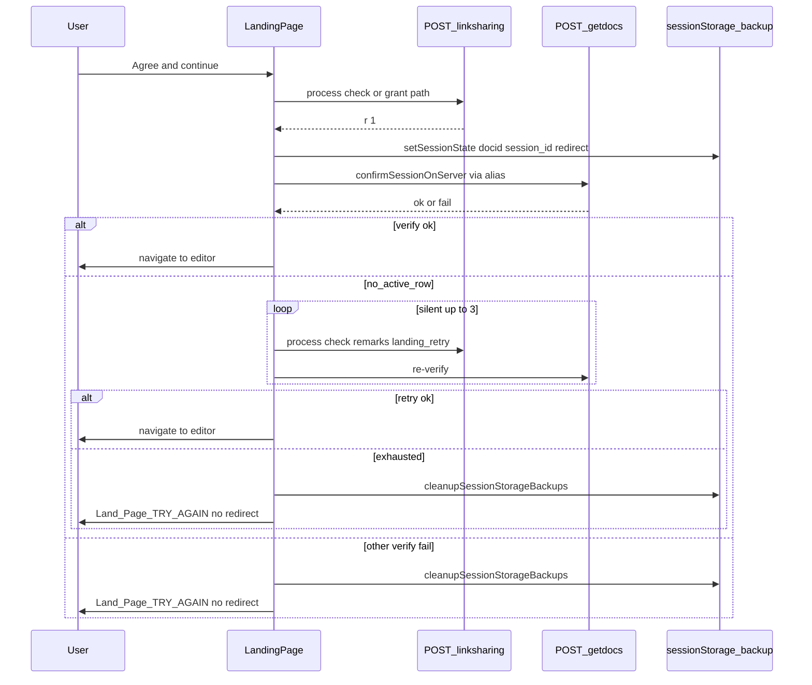
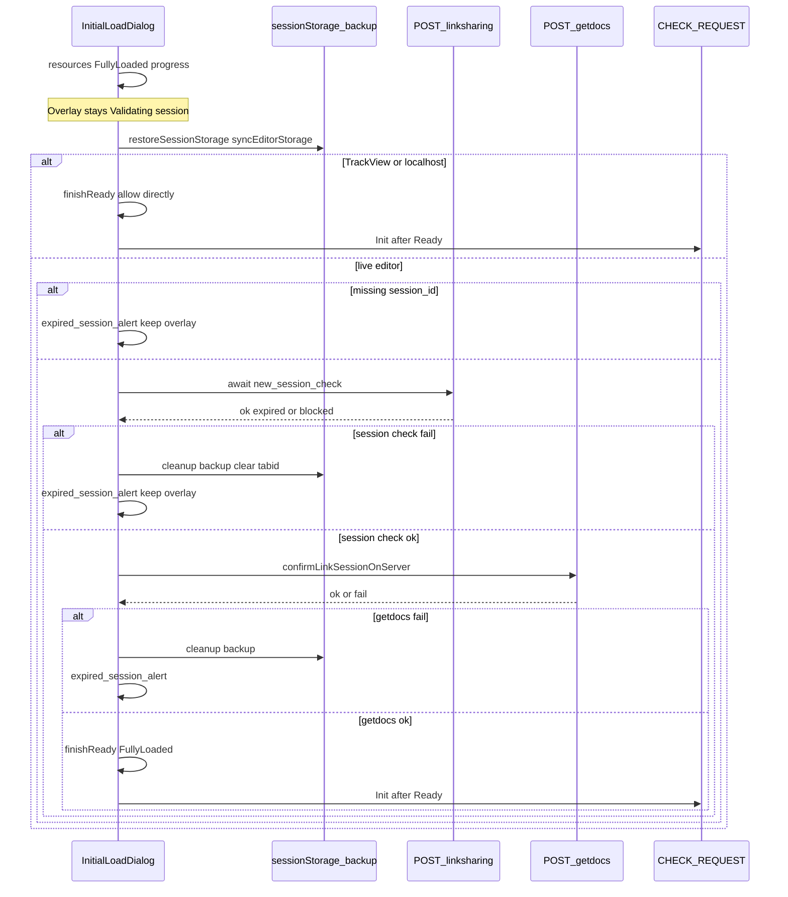

# Linksharing session — workflow

**Docs:** [skills.md](./skills.md) · [DEV.md](./DEV.md) · [QA.md](./QA.md) · [use_cases.md](./use_cases.md)

Backend map (reference only): [`../linksharing-frontend-backend-map.md`](../linksharing-frontend-backend-map.md).

---

## Landing grant (before redirect)

### Steps

1. Access grant (`check`, `update_open1`, poll grant, etc.) returns success.
2. `LinkSessionCore.completeAccessGrant` commits via `commitStorageAndRedirect` → `onRedirect` → **`setItemsandReDirect`** (pre-write getdocs removed to avoid double verify).
3. `setItemsandReDirect` writes `docid`, `xmleditor:sessionid:{docid}`, `redirect` via `setSessionState` (`mirror: true` → sessionbackup).
4. If `Options.redirect` and **not** `Options.skipVerify`: await `confirmLinkSessionOnServer({ docId, sessionId })` (alias → `LinkSessionCore.confirmSessionOnServer`).
5. **ok** → `window.location.href` to editor.
6. **`no_active_row`** → silent `retryLandingSessionCheck` up to **3** × (`process: check`, `remarks: landing_retry`) + re-verify; navigate on success; else cleanup + `Land_Page_TRY_AGAIN` (no auto-refresh).
7. **Other verify fail** → `cleanupSessionStorageBackups(docid)`, `clearEditorTabId`, `Invalid_Alertfn("Land_Page_TRY_AGAIN")`, **no** navigate.
8. Non-redirect call site (`redirect: false`) writes only — no navigate verify.

DB-error shaped check `r:0` (e.g. ClassCastException) must **not** grant/redirect — see DEV.md grant gate.

`onRedirect` must **await** async `setItemsandReDirect` so write/verify cannot race navigate.

---

## Editor open (InitialLoadDialog gate)

### Steps

1. Progress reaches end; `complete()` does **not** hide overlay yet — status `Validating session ...`; calls `validateSessionThenReady()`.
2. Restore storage.
3. **Track View or localhost:** log `track_view_allow` / `localhost_allow` → `finishReady()` (no seed, no expired alert).
4. **Live editor only:** require `session_id` → `new_session_check` → `confirmLinkSessionOnServer` → Ready or `expired_session_alert` (fail-closed).
5. On Ready → `onInitializeComplete` starts **`CHECK_REQUEST.Init()`** (editor).

Optional localhost seed helpers: `localHostSession.js` (E2E only — not Ready).

---

## Session end / handoff (summary)

Destructive or handoff paths that leave dual-guard relevant on next open. Full catalog: [DEV.md](./DEV.md).

| Trigger | Typical process | Effect |
|---------|-----------------|--------|
| User logout | `close` | `docstatus:0`, `session_end_time` set |
| Finalize / sign-off (non-collab) | `close` (remarks `signoff`) | Same close path |
| Finalize / sign-off (collab) | `signoff` via `buildSignoffPayload` / `PROCESS.SIGNOFF` | Close role rows |
| Idle Leave | `close` + remarks `idle_leave` | Idle sign-off redirect |
| LinkShare Accept / 30s timeout | `updatestatus_reqstatus` | Handoff (not `close`) |
| LinkShare Reject | `updatereqstatus` | `requeststatus:4` |
| Landing `VALIDATE_LAST_SAVE` | `close` | Stale landing auto-close |

After a real `close`, a hard refresh with stale sessionbackup must **fail verify** (or expired check) and clean backup + tab id — not flash Ready then Session Expired, and not endless `refresh` of a closed id.
