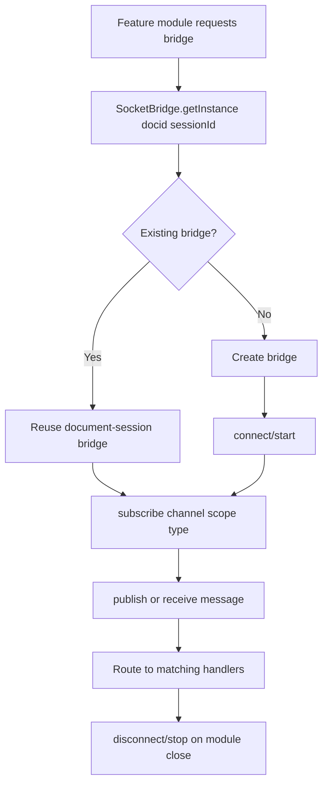
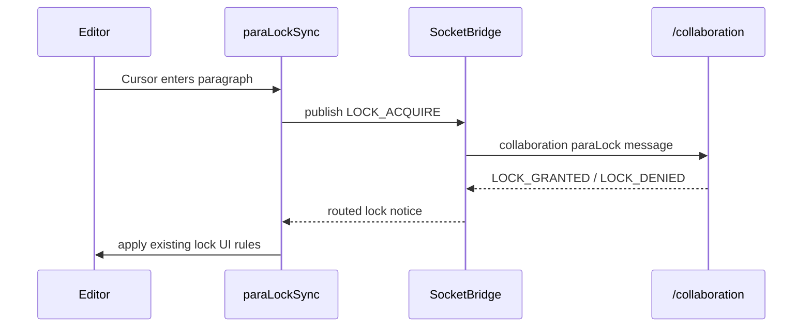
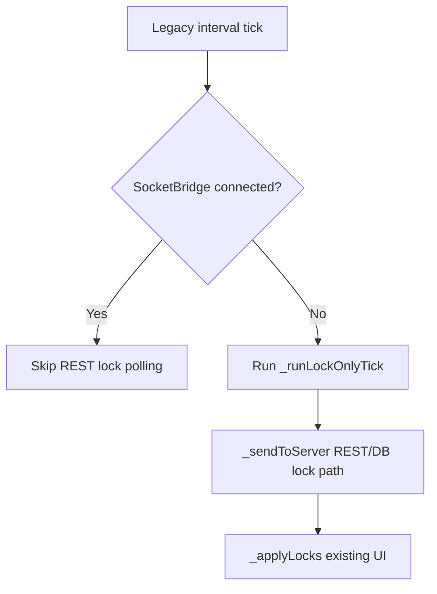
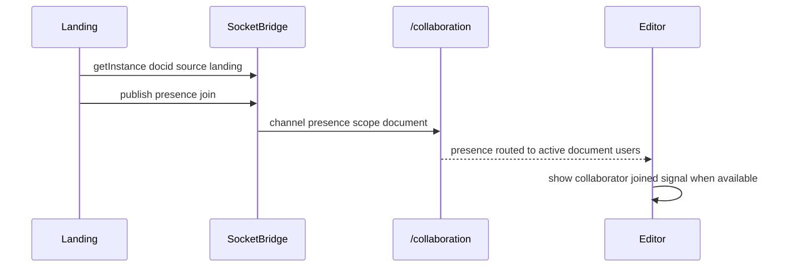
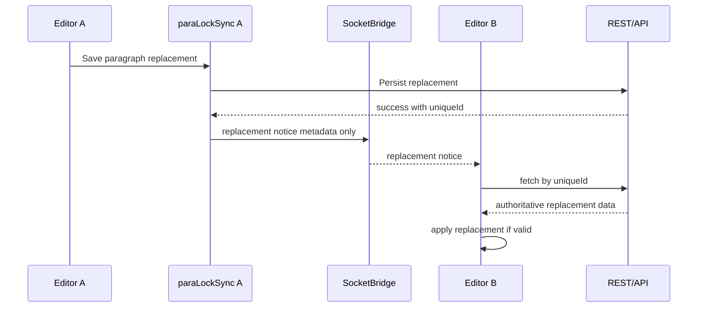

# SocketBridge — workflow

**Docs:** [skills.md](./skills.md) · [README.md](./README.md) · [DEV.md](./DEV.md) · [QA.md](./QA.md)

---

## SocketBridge lifecycle

## ParaLock connected path

## ParaLock fallback path

## Landing Page presence

## Replacement notice and fetch

---

## Notes

- SocketBridge carries live coordination and notification messages.
- REST/API remains authoritative for durable data and recovery.
- Backend `LOCK_*` authority is still pending; frontend routing is ready.
