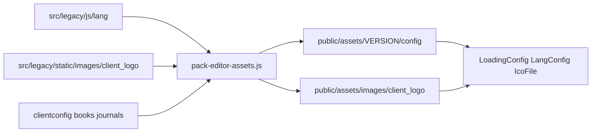

# LoadingConfig-critical assets pack — Design

**Date:** 2026-10-14  
**Status:** Approved for planning  
**Related:** [`2026-10-09-editor-hybrid-assets-pack-design.md`](2026-10-09-editor-hybrid-assets-pack-design.md)

---

## Goal

Pack the remaining **LoadingConfig boot-critical** static assets so Vite no longer serves SPA `index.html` (and thus `main.jsx`) for missing `/assets/...` URLs.

After this slice, `LangConfig` and `IcoFile` fetches succeed with real files, matching gulp layout for those paths.

## Problem

Hybrid pack deferred full config (“stub config dir… populate later”). A later pass copied only `clientconfig/books` and `clientconfig/journals`.

`LangConfig` requests `assets/{VERSION}/config/lang/en.js`. That file was never packed; Vite falls back to HTML.  
`IcoFile` requests `assets/images/client_logo/{CLIENT}_FAVICON.svg` (version-less); logos were never copied to `public/`.

`_initial*` script **order** in `e6_common` is already correct; this slice is **asset coverage only**.

## Non-goals

- Full gulp parity (`meta/*.json`, `modules/**`, `css/specific`, templates)
- Entire `clientconfig` beyond books/journals (`landing-pages`, `template`, root-only files)
- Changing HashRouter, boot order, or `applyLegacyGlobals`
- Re-including skipped `js/index.js`

## Approach

Extend [`scripts/pack-editor-assets.js`](../../../scripts/pack-editor-assets.js) (already run by `predev` / `prebuild`):

| Source | Destination |
|--------|-------------|
| `src/legacy/js/lang/*.js` | `public/assets/{VERSION}/config/lang/` |
| `src/legacy/static/images/client_logo/*` | `public/assets/images/client_logo/` |
| (unchanged) `src/legacy/clientconfig/books` | `public/assets/{VERSION}/config/books/` |
| (unchanged) `src/legacy/clientconfig/journals` | `public/assets/{VERSION}/config/journals/` |

`VERSION` continues to come from `resolveEditorVersion` / `ENV.VERSION` ∥ `package.json`.

Overwrite/replace destination trees on each pack run (same pattern as books/journals) so stale files do not linger.

## Runtime contracts

From [`_initialScriptLoader.js`](../../../src/legacy/js/_initialScriptLoader.js):

- **LangConfig:** `assets/{VERSION}/config/lang/{DEFAULT}.js` with `DEFAULT === "en"` (also pack `fr.js` for completeness).
- **IcoFile:** `assets/images/client_logo/{CLIENT.NAME.UPPER}_FAVICON.svg` — path is **not** versioned.
- **MetaConfig / split / ceg:** under `assets/{VERSION}/config/{dtd}/{client}/` — already covered by books/journals copy.

## Architecture

## Testing / verification

- After `npm run pack:editor` (or `node scripts/pack-editor-assets.js`):
  - `public/assets/{VERSION}/config/lang/en.js` exists and is non-empty JS
  - `public/assets/images/client_logo/` contains at least one `*_FAVICON.svg`
- Manual: `GET http://localhost:5173/assets/{VERSION}/config/lang/en.js` returns JavaScript, not HTML
- Manual: editor boot no longer fails LangConfig parse due to HTML body

## Success criteria

- Lang and client-logo LoadingConfig fetches return 200 with correct content type/body
- Books/journals packing still works
- No change required to editor boot order or React routes

## Follow-ups (explicitly later)

- Gulp `meta/` JSON, standalone modules under `assets/{VERSION}/modules/`, journal-specific CSS
- Remaining `clientconfig` trees if a fetch surfaces a 404→HTML fallback
