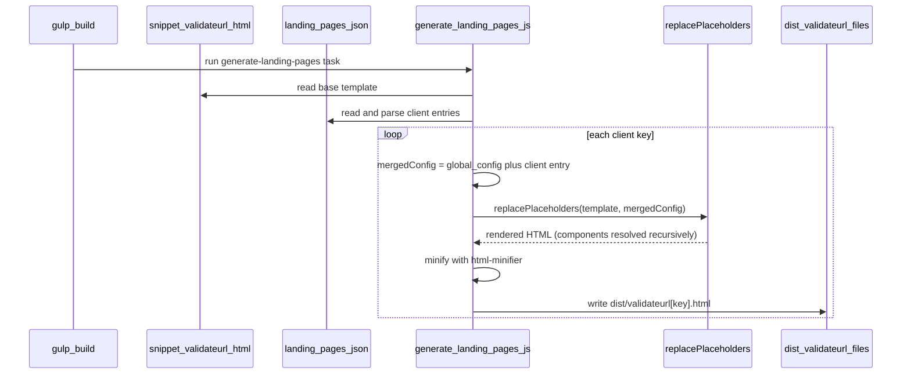
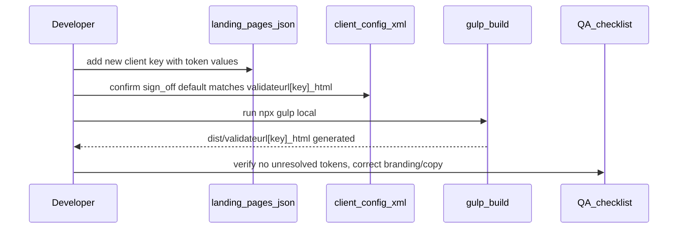

# Validate-URL landing pages — workflow

**Docs:** [skills.md](./skills.md) · [DEV.md](./DEV.md) · [QA.md](./QA.md)

---

## Build-time generation

### Steps

1. `gulp.task('build', ...)` runs `replace-html-templates` (generic `snippet/*.html` pass, excludes `validateurl*.html`), then `generate-landing-pages`.
2. `generate-landing-pages` reads `snippet/validateurl.html` once and `src/clientconfig/landing-pages.json` once.
3. For each client key (`default`, `acs`, `brill`, …), it merges that client's token values over `global.config` and calls the existing `replacePlaceholders` resolver — which recursively expands any `${{component}}$` tokens (e.g. `${{form_button_group}}$`, `${{doi_info}}$`/`${{doi_info_books}}$` via the `doi_component` indirection, `${{browser}}$`/`${{browser_opera}}$`) against `snippet/component/*.html`.
4. Output is minified with the same options used elsewhere in the pipeline, then written to `dist/validateurl.html` (`default`) or `dist/validateurl{key}.html`.
5. Nothing else in the build (or in `config.xml` redirects) changes — filenames are identical to the pre-refactor hand-authored files.

---

## Adding a new client

### Steps

1. Copy an existing client entry (or `default`) in `src/clientconfig/landing-pages.json` as a starting point for the new client's tokens (branding, welcome text, instructions/disclaimer HTML, doi_component, etc.).
2. Confirm the client's `config.xml` (`src/clientconfig/{journals,books}/{client}/config.xml`) `sign_off.default` points at `validateurl{key}.html?key=` with the matching key.
3. Rebuild — no HTML file, gulp task, or pipeline change needed for a client that fits the existing token set.
4. Run through [QA.md](./QA.md)'s per-client and "adding a new client" checks.

If the new client needs a genuinely new structural region (not just different text/links/branding), add a new `${{token}}$` to `snippet/validateurl.html` first and backfill a value (often an empty string) for that token in every existing client entry so old clients don't regress.
