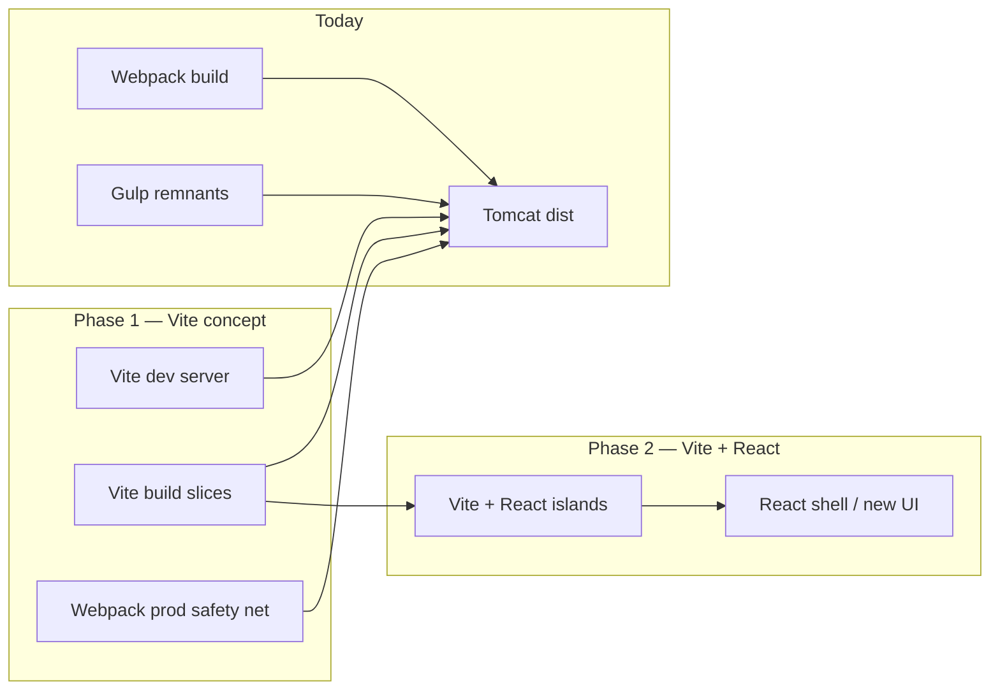

# Vite Migration Plan — IMPACT Web

> **2026-10-14 update (impact_vite SPA):** Hybrid `e6_*.min.js` packs under `assets/{VERSION}/` are a temporary bridge. VERSION comes from `package.json` / `ENV.VERSION` via `generate-env` + packer; no `${{VERSION}}$` in Slice A sources. Shared AJAX: `src/shared/legacyAjax.js`. See `docs/superpowers/plans/2026-10-14-pack-version-legacy-ajax.md`. Deep ESM `import()` retirement remains backlog. Sections below describe the older webpack/gulp baseline.

Slow, low-risk migration from **Gulp + Webpack** to **Vite**, then **Vite + React**. This plan is based on the current repo layout as of the webpack-primary build (`npm run build` → `webpack.config.js`).

---

## Current state (baseline)

### Build toolchain

| Layer | Status | Role |
|---|---|---|
| **Gulp** (`gulpfile.js`) | Legacy, still present | HTML/XML/config tasks; superseded for JS/CSS by webpack for most flows |
| **Webpack** (`webpack.config.js`) | **Active production build** | Entries from `utils/gulp/pipeline.js`, outputs to `dist/` |
| **Vite** | Not present | Target for Phase 1 |

### Output & deploy model

- Build writes to `dist/` → deployed under Tomcat `webapps/impactweb/`.
- Versioned assets: `assets/{VERSION}/js|css|modules|vendor/…`
- HTML templates: `snippet/*.html` (30 pages) with placeholders `${{VERSION}}$`, `${{API_PATH}}$`, etc.
- Post-build: `PlaceholderReplacePlugin` + `XmlProcessPlugin` + `CopyWebpackPlugin` (fonts, CKEditor, UI).

### Code architecture

```text
snippet/*.html          → static shell, script tags in fixed order
src/js/**               → legacy IIFE/globals, NO import/export (~40+ files per editor page)
src/modules/**/index.js → ES modules (export default), 37 lazy-loaded modules
src/modules/module_main.js → monolithic core (BaseModule, CheckOrder, ModuleRegistry) — no ESM
ckeditor/**             → full editor tree, copied + partial minify
src/static/lib/**       → vendor JS/CSS (jQuery, Bootstrap, ag-grid, …)
```

### Editor page load order (`editor6.html`)

1. Vendor scripts (`vendor_jbt`, `vendor_smt`, `e6_vendor`, mathlive)
2. `ckeditor-{VERSION}/ckeditor_dev.js`
3. `modules/browser-compatible/index.js`
4. `js/e6_common.min.js` (globals: `VERSION`, `API_PATH`, `IS_JOURNAL`, …)
5. `js/e6_main.min.js`
6. `modules/module_main.js` (registry + dynamic `import()`)
7. `js/dialog_module.min.js`
8. `modules/global_context.js`

### Dynamic module loading

`ModuleRegistry.loadModuleClass()` uses native `import(path)` against built files:

`assets/{VERSION}/modules/{module}/index.js`

Modules depend on **globals** (`GlobalEditor`, `BaseModule`, `commonMethods`, `IS_JOURNAL`, jQuery, etc.) — not npm imports.

### Migration constraints (non-negotiable)

1. **Tomcat + CKEditor** — editor must keep working; CKEditor stays external script initially.
2. **Placeholder config** — `${{KEY}}$` replacement must remain environment-aware (`environments/base.env.js`).
3. **Browser targets** — Chrome 72 / Firefox 66 / Edge 80 / Safari 14.1 (webpack Babel today).
4. **Zero big-bang** — webpack keeps shipping prod until each slice has parity.
5. **37 modules + editor** — highest value, highest coupling to globals.

---

## Strategy overview



**Principle:** Strangler pattern — Vite absorbs one vertical slice at a time; webpack fills everything else.

---

# Phase 1 — Migrate Vite concept (FOCUS)

**Goal:** Introduce Vite for **dev velocity** and **incremental builds**, without breaking Tomcat deployment or the editor. Webpack remains the production fallback until parity is proven per slice.

**Duration estimate:** 8–14 weeks (part-time / alongside feature work).

---

## Phase 1 — Step 0: Prerequisites & inventory (Week 1)

### Tasks

- [ ] Document all webpack entries from `pipeline.js` → `PAGES` (page bundles, vendors, modules, CKEditor).
- [ ] List global variables required before each script runs (`src/js/index.js`, `_initialGlobalVaribale.js`).
- [ ] Confirm CI path: which script runs today (`npm run build:uat`, packaging PS1).
- [ ] Add `docs/vite-migration-tracker.md` checklist (slice-by-slice status).

### Deliverable

Baseline matrix: **entry name → source files → dist output path → HTML pages that reference it**.

---

## Phase 1 — Step 1: Add Vite scaffold (Week 1–2)

### Tasks

- [ ] Install dev deps: `vite`, `@vitejs/plugin-legacy` (match Babel targets), `sass` (already present).
- [ ] Create `vite.config.js` at repo root — **do not remove webpack**.
- [ ] Add npm scripts:

  ```json
  "dev:vite": "vite",
  "build:vite:modules": "vite build --config vite.config.js",
  "preview:vite": "vite preview"
  ```

- [ ] `.gitignore` — Vite cache (`.vite/`) only; still commit `dist/` if that is current practice.

### `vite.config.js` initial shape

```javascript
// Conceptual — first commit is dev-only, no prod cutover
export default defineConfig(({ mode }) => ({
  root: '.',
  publicDir: false,           // avoid copying whole repo; explicit later
  build: {
    outDir: 'dist-vite',      // NEVER overwrite webpack dist/ initially
    emptyOutDir: true,
    sourcemap: true,
    target: 'es2015',
  },
  server: {
    port: 5173,
    proxy: {
      // API + Tomcat HTML/assets not served by Vite
      '/impactapinew': { target: 'http://localhost:8080', changeOrigin: true },
      '/impactweb': { target: 'http://localhost:8080', changeOrigin: true },
    },
  },
}));
```

### Deliverable

`npm run dev:vite` starts without error (even if it only serves a stub).

---

## Phase 1 — Step 2: Shared build utilities (Week 2)

Extract webpack-only logic into reusable Node modules (used by **both** bundlers):

| Utility | Source today | New location |
|---|---|---|
| Environment bootstrap | `webpack.config.js` top | `build/env.js` |
| Pipeline / page map | `utils/gulp/pipeline.js` | keep, import from Vite config |
| Placeholder replace | `utils/gulp/replacePlaceholders.js` | `build/plugins/placeholder-replace.js` |
| XML / journal splits | `XmlProcessPlugin` | `build/tasks/xml-process.js` |
| Copy patterns | `buildCopyPatterns()` | `build/copy-assets.js` |

### Vite plugin: placeholder replace

Run **after** `vite build`, same as webpack `PlaceholderReplacePlugin`:

```text
dist-vite/**/*.{js,html,css,xml} → replace ${{KEY}}$ from getConfig(env)
```

### Deliverable

`node build/post-build.js --bundler vite --env local` produces correct `VERSION` / `API_PATH` in output.

---

## Phase 1 — Step 3: Vite dev — module sandbox (Week 3–4)

**First real Vite win:** fast HMR for `src/modules/**` development.

### Tasks

- [ ] Create `dev/module-sandbox.html` — minimal page loading globals from Tomcat or prebuilt `dist/`.
- [ ] Configure Vite `server.proxy` so sandbox can load:
  - `assets/{VERSION}/js/e6_common.min.js` from Tomcat
  - `ckeditor-*` from Tomcat
  - vendor bundles from Tomcat
- [ ] Point Vite entry at **one** module, e.g. `src/modules/notes_group/index.js`.
- [ ] Shim globals in `dev/globals-shim.js` or rely on script tags in sandbox HTML.

### Module resolution

```javascript
resolve: {
  alias: {
    '@modules': path.resolve(__dirname, 'src/modules'),
    '@js': path.resolve(__dirname, 'src/js'),
  },
},
```

### Handling `BaseModule` dependency

Modules extend `BaseModule` from `module_main.js` (not imported). Short-term:

- Load `module_main` bundle via `<script>` before module in sandbox, **or**
- Add `dev/module-dev-entry.js` that imports nothing but expects globals.

### Deliverable

Edit `notes_group/index.js` → HMR updates without full webpack rebuild.

---

## Phase 1 — Step 4: Vite multi-entry — `src/modules/**/index.js` (Week 4–6)

Replicate webpack entry:

```javascript
glob.sync('src/modules/**/index.js').forEach(file => {
  entry[`modules/${name}`] = file;
});
```

### Tasks

- [ ] Vite `build.rollupOptions.input` — all 37 module entries.
- [ ] Output format: **ESM** (`format: 'es'`) to match current `import()` usage.
- [ ] Output path: `dist-vite/assets/{version}/modules/{name}/index.js` (mirror webpack).
- [ ] Compare file size + smoke test: `import('./assets/.../notes_group/index.js')` in editor.
- [ ] `module_main.js` must remain compatible (still webpack-built in this step).

### Risk: `export default` + class extends global `BaseModule`

Modules do not import `BaseModule`; Vite may tree-shake or scope differently. **Mitigation:** keep `external` config for globals or IIFE shim.

```javascript
build: {
  rollupOptions: {
    external: [], // globals via script tags, not externals
  },
},
```

### Deliverable

`npm run build:vite:modules` → byte-compare key modules vs webpack output; Playwright smoke on one module dialog.

---

## Phase 1 — Step 5: Vite lib build — `module_main` + `global_context` (Week 6–8)

Hardest Phase 1 slice — 5,600+ line `module_main.js` + `ContextMenuGroup.js`, no ESM.

### Options (pick A first)

| Option | Approach | Effort |
|---|---|---|
| **A (recommended)** | Vite builds as **IIFE** single file, same globals as today | Medium |
| B | Split `module_main` into ESM modules with explicit exports | High |
| C | Leave on webpack indefinitely | Low progress |

### Tasks (Option A)

- [ ] Entries: `src/modules/module_main.js`, `src/modules/ContextMenuGroup.js` (order preserved).
- [ ] `build.lib` or rollup `output.format: 'iife'`, `name: 'ImpactModuleCore'`.
- [ ] Verify `ModuleRegistry`, `CheckOrder`, `BaseModule` on `window`.
- [ ] `global_context`: bundle all `**/context.js` into one file (match webpack `global_context` page).

### Deliverable

Editor6 loads Vite-built `module_main.js` from `dist-vite` in local test; lazy modules still work.

---

## Phase 1 — Step 6: Vite page bundles — low-risk pages first (Week 8–10)

Migrate **simple** `PAGES` entries before editor core:

| Priority | Page key | Why |
|---|---|---|
| 1 | `workflows` | Single JS + CSS, no CKEditor |
| 2 | `releasenote` | Simple |
| 3 | `videotour` | Medium |
| 4 | `dashboard` / `login` | Wider deps but no editor |
| … | `landing` | More scripts |
| Last | `e6_common`, `e6_main`, `dialog_module` | Entire editor depends on these |

### Per-page Vite entry

```javascript
// vite.entries/workflows.js
import '../../src/js/index.js';      // needs placeholder pre-processing OR define injection
import '../../src/js/common/workflows.js';
```

### Placeholder problem in `src/js/index.js`

Source contains `${{VERSION}}$` — not valid runtime JS until replaced.

**Solutions (pick one):**

1. **Pre-process** source at build time via `vite-plugin-transform` (reuse `replacePlaceholders`).
2. **`define`** inject from `getConfig(env)` for known keys; migrate `index.js` gradually to `import.meta.env`.
3. **Keep `index.js` on webpack** until Step 7.

**Recommendation:** Option 1 for Phase 1; Option 2 as gradual cleanup.

### Deliverable

`workflows.html` served from `dist-vite` with passing E2E or manual QA.

---

## Phase 1 — Step 7: HTML pipeline in Vite (Week 10–11)

Webpack uses `HtmlWebpackPlugin` for all `snippet/*.html`.

### Tasks

- [ ] `vite-plugin-html` or custom middleware to process `snippet/*.html`.
- [ ] Apply `templateParameters` from `getConfig(env)`.
- [ ] Minify HTML (match webpack minify options).
- [ ] Output to `dist-vite/snippet/` then copy to `dist-vite/` root (match gulp `copyHtmlProcess`).

### Deliverable

Full `dist-vite/` folder structure mirrors `dist/` for one environment (local).

---

## Phase 1 — Step 8: Asset copy + CKEditor + XML (Week 11–12)

Port non-JS webpack plugins:

- [ ] `build/copy-assets.js` — fonts, UI, release-notes JSON, mathlive, ag-grid.
- [ ] CKEditor — **copy only** (same as webpack); plugin minify can stay webpack-side initially.
- [ ] `xml-process` — journal splits, client config XML.
- [ ] `version.txt` generation.

### Deliverable

`dist-vite/` is deployable to a Tomcat test instance for full regression.

---

## Phase 1 — Step 9: Dual-build CI & cutover gates (Week 12–14)

### CI matrix

```text
job webpack-build   → dist/        → Playwright full suite
job vite-build      → dist-vite/   → Playwright subset → growing
```

### Cutover criteria (per slice)

| Gate | Requirement |
|---|---|
| Output parity | Module paths match `assets/{VERSION}/modules/...` |
| Placeholders | No remaining `${{` in shipped JS/HTML |
| Editor smoke | Open doc, insert footnote, query, comment |
| Track view | `editor6TrackView.html` loads |
| Performance | Vite prod bundle ≤ webpack + 5% size |
| Rollback | `npm run build:prod` unchanged one command |

### Gradual prod switch

1. Modules only (Vite) + webpack for everything else.
2. `module_main` + modules (Vite).
3. `e6_*` bundles (Vite).
4. Full Vite prod; webpack archived.

### Deliverable

Team agreement on **slice 1 prod cutover** (recommend: modules only).

---

## Phase 1 — What NOT to do

- Do not rewrite `src/js/**` to ESM in Phase 1.
- Do not bundle CKEditor inside Vite initially.
- Do not change Tomcat context path or HTML script order without testing.
- Do not remove webpack until `dist-vite` passes full regression.
- Do not add React in Phase 1 (prep only: folder structure, alias).

---

## Phase 1 — Suggested folder additions

```text
build/
  env.js
  pipeline.js          # thin re-export of utils/gulp/pipeline.js
  post-build.js
  plugins/
    placeholder-replace.vite.js
  copy-assets.js
  tasks/
    xml-process.js
dev/
  module-sandbox.html
  globals-shim.js
vite.config.js
vite.config.modules.js # optional split config
docs/
  vite-migration-plan.md        # this file
  vite-migration-tracker.md     # slice checklist (create in Step 0)
```

---

# Phase 2 — Vite + React (outline)

**Goal:** New UI and migrated dialogs use React; CKEditor + legacy globals remain as embedded islands until fully replaced.

**Prerequisite:** Phase 1 Step 4+ complete (Vite builds modules reliably).

---

## Phase 2 — Step 1: React infrastructure (Week 1–2)

- [ ] `@vitejs/plugin-react`, `react`, `react-dom`.
- [ ] `src/react/` — new code only; do not move `src/js` yet.
- [ ] Shared tokens/CSS variables bridging Bootstrap 4 and React components.
- [ ] Vitest + React Testing Library for new components.

---

## Phase 2 — Step 2: Island architecture (Week 3–6)

```text
editor6.html (unchanged shell)
  └── <div id="react-toolbox-root"></div>   ← new
  └── existing CKEditor + globals
  └── module registry (lazy)
```

- [ ] `mountReactIsland(id, Component, props)` helper.
- [ ] First island: low-risk UI (e.g. release notes viewer, workflow diagram).
- [ ] Bridge: `window.GlobalEditor`, `IMPACT_SELECTION`, `commonMethods` via typed `legacy-bridge.ts`.

---

## Phase 2 — Step 3: Module dialog migration pattern (Week 6–12)

Migrate one module end-to-end as template:

| Candidate | Pros | Cons |
|---|---|---|
| `guide_tour` | Small | Low impact |
| `tooltip` | Small | Tightly coupled |
| `notes_group` | High value | Summernote, CKEditor deps |
| `ref_form` | High value | Very large |

**Pattern:**

1. React dialog shell + form state.
2. Keep business logic in existing JS class; wrap with hooks.
3. Gradually extract pure functions to `src/react/features/{name}/`.
4. Playwright tests per module.

---

## Phase 2 — Step 4: Editor shell (Week 12+)

- [ ] React header / toolbar region (download PDF, menus).
- [ ] Keep `GlobalEditor` in non-React zone.
- [ ] Context menus → React portals over CKEditor iframe.
- [ ] State: Zustand or Redux Toolkit for UI; editor state stays in CKEditor.

---

## Phase 2 — Step 5: Deprecate legacy dialogs

- [ ] `dialog_module` webpack bundle shrinks as modules move to React.
- [ ] jQuery UI dialogs replaced per module.
- [ ] Long-term: `module_main` registry loads React lazy routes.

---

## Phase 2 — Risks

| Risk | Mitigation |
|---|---|
| CKEditor + React re-render conflicts | Strict island boundaries; no React above editor iframe |
| Global state spaghetti | `legacy-bridge` + document one source of truth per concern |
| Bundle size | Route-level code splitting; keep vendor external |
| QA surface | Module-by-module Playwright coverage before cutover |

---

## Decision log (recommended)

| Decision | Phase 1 choice |
|---|---|
| Prod bundler during migration | Webpack until slice gates pass |
| Vite `outDir` | `dist-vite` until full cutover |
| Module format | ESM (keep `import()`) |
| `module_main` format | IIFE first, ESM split later |
| CKEditor | Static copy, not Vite entry |
| Config placeholders | Reuse `replacePlaceholders` post-build |
| React start | Phase 2 only, `src/react/` |

---

## Quick reference — key files today

| File | Role |
|---|---|
| `webpack.config.js` | Active bundler |
| `utils/gulp/pipeline.js` | Entry map (`PAGES`) |
| `environments/base.env.js` | Env config + `generateFrontendConfig` |
| `snippet/editor6.html` | Editor script order |
| `src/modules/module_main.js` | Core registry + BaseModule |
| `src/js/index.js` | Global env vars (placeholder syntax) |
| `package.json` | `build`, `build:local`, `watch` |

---

## Phase 1 immediate next actions (this sprint)

1. Create `vite.config.js` + `npm run dev:vite` (Step 1).
2. Extract `build/env.js` from webpack bootstrap (Step 2).
3. Build `dev/module-sandbox.html` for `notes_group` HMR (Step 3).
4. Open tracking issue per pipeline `PAGES` key.

Phase 2 starts only after **Vite builds all `src/modules/**/index.js`** with passing editor module smoke tests.
